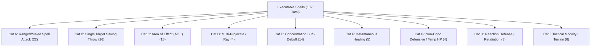

# 5E Project — Content and Mechanics Audit Report

**Date:** October 2026  
**Rulesets Evaluated:** SRD 5.2 5e (2014 SRD 5.1 & 2024 SRD 5.2 / PHB)  
**System Architecture:** Django REST Framework (Backend) + Next.js Turbopack (Frontend)  
**Testing Protocol Reference:** [AGENT_INSTRUCTIONS.md](file:///c:/dnd-backend/dnd-backend/AGENT_INSTRUCTIONS.md)

---

## 1. Executive Summary

This audit assesses the state of gameplay mechanics, data sources, automated test coverage, and implementation gaps across the 5e portal codebase.

| Domain | Total DB Records | Executable in Engine | Purely Descriptive | Automated Test Coverage | Status |
| :--- | :--- | :--- | :--- | :--- | :--- |
| **Classes** | 12 | 12 (Core loop + key features) | High-tier passive traits | 10 dedicated test files | **Solid Core / Partial High-Tier** |
| **Subclasses** | 12 (SRD 5.2 official baseline) | **12 wired in combat engine** (Champion, Hunter, Fiend, Open Hand, Thief, Life, Devotion, Berserker, Evocation, Lore, Land, Draconic) | 0 descriptive only | `test_subclasses.py` (24 automated tests) | **100% SRD 5.2 Complete** |
| **Species / Races** | 21 (9 '14, 12 '24) | 12 (Darkvision, Resistances, Fey Ancestry, Relentless, etc.) | Minor flavor traits | 4 dedicated test files | **High** |
| **Spells** | 225 | **104** damage/combat, **38** buffs/defenses, **5** AOE templates | ~78 utility/ritual/social | 10 test files (144+ tests) | **Robust Combat & Buff Mechanics** |
| **Class Features** | 142 | **27** active combat triggers + passives (Styles, Masteries, Metamagic) | ~115 descriptive/out-of-combat | `test_class_features.py`, `test_weapon_mastery.py`, `test_sorcery_metamagic.py` | **Core Combat Implemented** |
| **Feats / Boons** | 28 (4 Origin, 24 Boons) | 4 (Grappler, Tough, Epic Boons) | 24 passive stat modifiers | `test_epic_boons.py`, `test_grapple_mechanics.py` | **Core Implemented** |
| **Monsters / Enemies** | 322 | Complete stats, attacks, actions, spells, legendary actions | Lore descriptions | `test_monster_actions.py`, `test_parsers.py` | **Fully Operational** |
| **Items & Equipment** | 1,498 (67 weapons, 32 armors) | 2H/Dual wield restrictions, AC calc, ranges, potions | Magic item lore text | 6 test files | **High** |
| **Dying & Survival** | Core 5e Rules | **100% Implemented** (Death Saves, Massive Damage Instant Death, Damage at 0 HP, Stabilization, *Spare the Dying*, Healer's Kit, Grave Domain Circle of Mortality) | 0 descriptive only | `test_dying_mechanics.py` (20 automated tests) | **100% SRD 5.1 & 5.2 Complete** |
| **Summoning & Minions** | Core 5e Spells | **100% Implemented** (Spiritual Weapon, Flaming Sphere, Animate Dead, Find Familiar, Conjure Spells, Concentration linkage, commands, grid tokens) | 0 descriptive only | `test_summoning.py` (9 automated tests) | **100% SRD 5.1 & 5.2 Complete** |
| **Cumulative Exhaustion (2024)** | 2024 Core Rules | **100% Implemented** (Levels 1–10, d20 Tests penalty, Spell DC penalty, Speed reduction, Lethal threshold death at 10, Long Rest recovery, M2M condition sync) | 0 descriptive only | `test_exhaustion_engine.py` (10 automated tests) | **100% 2024 Complete** |

---

## 2. Architecture & Data Sources

### 2.1 Data Layers
1. **Database Models (PostgreSQL / SQLite)**:
   - `characters.CharacterClass`: 12 classes with hit dice, primary abilities, saving throws.
   - `characters.CharacterRace`: 21 species records with sizes, speeds, traits JSON, skill proficiencies, ruleset flags (`2014`, `2024`).
   - `characters.CharacterBackground`: 5 backgrounds (2024 Backgrounds grant Origin Feats and ASIs).
   - `characters.Character`: Tracks XP, level, class, subclass, race, background, inspiration, death saves.
   - `characters.CharacterStats`: Ability scores, hit points, temporary hit points, AC, speed, spell slots (`JSONField`), expended spell slots.
   - `characters.CharacterFeature`: Stores assigned racial, class, and subclass features.
   - `characters.CharacterSpell`: Prepared/known spells linked to `spells.Spell`.
   - `spells.Spell`: 225 imported spells containing name, level, school, casting time, range, components, duration, description.
   - `bestiary.Enemy`: 322 enemies containing challenge ratings, hit points, AC, speeds, legendary action counts, linked attacks/abilities/actions.
   - `items.Weapon` & `items.Armor`: Weapon damage dice, damage types, properties (Finesse, Heavy, Reach, Thrown, Light, Versatile, Two-Handed), armor bases and stealth disadvantage.
   - `combat.CombatSession` & `combat.CombatParticipant`: Ephemeral combat state, initiative queue, current turn, participant conditions, temporary HP, buffs, feature uses (`JSONField`).

2. **Hardcoded Rules Engines (Python Modules)**:
   - `combat/spell_rules.py`:
     - `SPELL_RULES` (83 spells): Defines attack types, saving throws, damage dice, damage types, base levels, riders, and scaling formulas.
     - `BUFF_SPELL_RULES` (19 spells): AC bonuses, bonus dice (Bless/Guidance), temp HP, concentration flags.
     - `scale_cantrip_damage()`: Level 1–4 (1x), 5–10 (2x), 11–16 (3x), 17–20 (4x).
     - `scale_upcast_spell_damage()`: Standard additive, multi-ray (*Scorching Ray*), stepped (*Spiritual Weapon*), pool (*Sleep*), high-tier (*Disintegrate*).
   - `combat/aoe_utils.py`:
     - `AOE_SPELL_TEMPLATES` (5 templates): Spheres (*Fireball*), Cones (*Burning Hands*, *Cone of Cold*), Lines (*Lightning Bolt*), Cubes (*Thunderwave*).
     - `get_aoe_targets()`: Trigonometric point-in-polygon and distance collision detection on the tactical grid.
   - `combat/condition_effects.py`:
     - Complete 5e condition advantage/disadvantage matrices (Prone, Paralyzed, Stunned, Blinded, Restrained, Incapacitated, Unconscious).
   - `campaigns/class_features_data.py`:
     - Dictionary definitions for 2014 and 2024 class features and subclass level progressions (levels 1–20).
   - `campaigns/racial_features_data.py`:
     - Feature names and descriptions for all species.

---

## 3. Implemented vs. Descriptive Content Inventory

### 3.1 Classes & Subclasses (SRD 5.2 Reference Baseline)
| Class | Official SRD 5.2 Subclass | 2024 Features Configured | Executable Mechanics in Combat Engine |
| :--- | :--- | :--- | :--- |
| **Barbarian** | **Path of the Berserker** | Levels 1–20 | **Rage** (damage resistance, +rage damage, end rage), **Reckless Attack** (advantage on attack, gives enemy advantage), **Unarmored Defense** (10+DEX+CON), **Brutal Critical** (extra crit dice). |
| **Fighter** | **Champion** | Levels 1–20 | **Action Surge** (restores action + attacks), **Second Wind** (1d10+lvl heal as bonus action), **Indomitable** (save reroll), **Extra Attack** (2/3/4 attacks), **Weapon Masteries**, **Fighting Styles**. |
| **Rogue** | **Thief** | Levels 1–20 | **Sneak Attack** (1d6 scaling, requires advantage or adjacent ally, finesse/ranged), **Cunning Action** (Dash/Disengage/Hide as bonus action), **Uncanny Dodge** (half incoming damage reaction), **Weapon Masteries**. |
| **Cleric** | **Life Domain** | Levels 1–20 | **Turn Undead** (Channel Divinity WIS save vs Frightened), **Destroy Undead** (instakills below CR threshold), **Preserve Life** (Life Cleric healing pool), full spellcasting. |
| **Paladin** | **Oath of Devotion** | Levels 1–20 | **Divine Smite** (slot-expended radiant damage + fiend/undead bonus), **Lay on Hands** (pool heal & cure poison), **Sacred Weapon**, **Turn the Unholy**, extra attack, **Weapon Masteries**, **Fighting Styles**. |
| **Monk** | **Warrior of the Open Hand** | Levels 1–20 | **Flurry of Blows** (1 Ki -> 2 unarmed strikes), **Martial Arts** (bonus unarmed strike), **Patient Defense** (1 Ki -> Dodge), **Step of the Wind** (1 Ki -> Dash/Disengage), **Stunning Strike** (CON save vs Stunned), **Unarmored Defense** (10+DEX+WIS). |
| **Druid** | **Circle of the Land** | Levels 1–20 | **Wild Shape** (beast transformation, temp HP pool, reversion on 0 HP), full spellcasting. |
| **Wizard** | **School of Evocation** (Evoker) | Levels 1–20 | **Arcane Recovery** (regain spell slots), spellbook ritual casting, full spellcasting. |
| **Bard** | **College of Lore** | Levels 1–20 | **Bardic Inspiration** (grants d6–d12 inspiration die to target ally), full spellcasting. |
| **Warlock** | **Fiend Patron** | Levels 1–20 | **Pact Magic** (uniform slot level casting, upcasting cantrips & spells), short rest slot recovery. |
| **Sorcerer** | **Draconic Sorcery** | Levels 1–20 | **Font of Magic** (slot-to-SP & SP-to-slot conversion), **6 Metamagic Options** (Quickened, Twinned, Subtle, Empowered, Heightened, Careful), full spellcasting. |
| **Ranger** | **Hunter** | Levels 1–20 | Spellcasting, extra attack, martial weapons, **Weapon Masteries**, **Fighting Styles**. |

### 3.2 Species / Races
| Species / Race | Ruleset | Executable Mechanics |
| :--- | :--- | :--- |
| **Human** | 2014 & 2024 | Extra Language ('14), +1 All Stats ('14), Heroic Inspiration on Long Rest ('24), Free Origin Feat ('24). |
| **Elf** | 2014 & 2024 | Darkvision (60 ft.), Fey Ancestry (immune to magical sleep, advantage vs charm), Trance (4 hr rest), Keen Senses (Perception proficiency). |
| **Dwarf** | 2014 & 2024 | Darkvision (60/120 ft.), Dwarven Resilience (poison resistance & save advantage), Dwarven Toughness (+1 HP/lvl), Stonecunning. |
| **Halfling** | 2014 & 2024 | Lucky (automatic reroll on d20 natural 1), Halfling Nimbleness (move through larger creatures), Brave (advantage vs frightened). |
| **Dragonborn** | 2014 & 2024 | Breath Weapon (elemental save damage), Damage Resistance (draconic element), Darkvision. |
| **Gnome** | 2014 & 2024 | Darkvision, Gnome Cunning (advantage on INT/WIS/CHA magic saving throws). |
| **Half-Elf** | 2014 Only (Legacy) | Darkvision, Fey Ancestry, Skill Versatility (two bonus skills). Removed in 2024 / SRD 5.2. |
| **Half-Orc** | 2014 Only (Legacy) | Darkvision, Menacing (Intimidation), Relentless Endurance (drop to 1 HP instead of 0 once/long rest), Savage Attacks (extra weapon die on crit). Removed in 2024 / SRD 5.2. |
| **Tiefling** | 2014 & 2024 | Darkvision, Hellish Resistance (fire damage resistance), Infernal Legacy / Thaumaturgy. |
| **Orc** | 2024 | Darkvision (120 ft.), Relentless Endurance, Adrenaline Rush (bonus action dash + temp HP). Added in SRD 5.2. |
| **Goliath** | 2024 | 35 ft. base speed, Powerful Build, Giant Ancestry, Large Form (level 5). Added in SRD 5.2. |

---

## 4. Spells Implementation Taxonomy & Categories

The 102 executable spells fall into **9 distinct mechanical implementation patterns**. These patterns serve as reusable blueprints for future test writing and spell implementations.

### Category Overview & Test Templates
1. **Category A: Spell Attack Roll (Single Target)**
   - *Examples*: *Fire Bolt, Eldritch Blast, Guiding Bolt, Inflict Wounds, Ray of Frost, Shocking Grasp, Chill Touch, Thorn Whip, Primal Savagery*.
   - *Mechanic*: Caster d20 + Spell Attack Bonus vs Target AC. On hit: rolled damage + damage type. On crit: double dice. Rider effects applied (e.g. *Ray of Frost* -10 ft speed, *Shocking Grasp* prevents reactions).
   - *Reusable Test Template*: Verify attack roll vs AC thresholds, crit calculation, damage resistance, and rider condition application.

2. **Category B: Single Target Saving Throw**
   - *Examples*: *Sacred Flame, Toll the Dead, Vicious Mockery, Hold Person, Blindness/Deafness, Disintegrate, Frostbite, Mind Sliver, Poison Spray*.
   - *Mechanic*: Target rolls d20 + specified saving throw modifier vs Caster Spell Save DC. Success: 0 damage (cantrips) or half damage / avoids condition. Failure: full damage and/or condition applied (e.g. Paralyzed for *Hold Person*).
   - *Reusable Test Template*: Test DC vs target save modifier, condition applied on failure, condition resisted on success, and condition immunity.

3. **Category C: Area of Effect (AOE)**
   - *Examples*: *Fireball, Lightning Bolt, Burning Hands, Cone of Cold, Thunderwave, Shatter, Ice Storm, Flame Strike*.
   - *Mechanic*: Shape origin & dimensions -> `get_aoe_targets()` -> individual saving throws per target creature -> half damage on success, full damage on failure.
   - *Reusable Test Template*: Multi-target grid positioning test, individual save rolls, obstacle collision, half-damage rounding down.

4. **Category D: Multi-Projectile / Multi-Ray**
   - *Examples*: *Magic Missile, Scorching Ray, Eldritch Blast (level 5+)*.
   - *Mechanic*: Multiple individual rolls or guaranteed hits (*Magic Missile* 3 darts @ lvl 1 + 1/level). Can target single creature or be distributed across multiple targets.
   - *Reusable Test Template*: Split-target distribution test, Shield spell interception, multi-ray attack rolls.

5. **Category E: Concentration Buff / Debuff**
   - *Examples*: *Bless, Haste, Hold Person, Fly, Invisibility, Blur, Shield of Faith, Protection from Evil and Good, Heroism*.
   - *Mechanic*: Sets `concentrating=True` on caster. Applies buff or condition to target. When caster takes damage, triggers CON save (DC = max(10, damage/2)). Failure removes buff/condition from all targets. Caster casting another concentration spell drops the first.
   - *Reusable Test Template*: Buff application, AC/bonus die verification, damage interruption check, single-concentration enforcement.

6. **Category F: Instantaneous Healing & Restoration**
   - *Examples*: *Cure Wounds, Healing Word, Mass Cure Wounds, Aid*.
   - *Mechanic*: Target recovers HP up to max HP. Validates target is living creature (cannot heal undead/constructs). Upcast scaling (+1d8/slot).
   - *Reusable Test Template*: HP delta check, overheal capping, undead target rejection, death save clearance on 0 HP target.

7. **Category G: Non-Concentration Defensive Buff & Temp HP**
   - *Examples*: *Armor of Agathys, False Life, Mage Armor, Mirror Image, Aid*.
   - *Mechanic*: Grants temporary HP, modifies unarmored AC base (13+DEX for Mage Armor), or spawns duplicate decoys. Does not require concentration.
   - *Reusable Test Template*: Temp HP replacement vs non-stacking rules, cold retaliation damage on melee hit (*Armor of Agathys*), duplicate tracking.

8. **Category H: Reaction Defense & Retaliation**
   - *Examples*: *Shield, Hellish Rebuke, Absorb Elements*.
   - *Mechanic*: Triggered out of turn in response to incoming attack or damage. Consumes participant reaction. Modifies incoming hit outcome or deals retaliatory damage.
   - *Reusable Test Template*: Reaction availability check, AC retroactively turning hit into miss, reaction exhaustion until next turn.

9. **Category I: Tactical Mobility & Environmental Surface**
   - *Examples*: *Misty Step, Grease, Web, Fog Cloud, Darkness, Spike Growth*.
   - *Mechanic*: Instantaneous teleportation or creation of persistent environmental tiles on the battle grid affecting movement cost and visibility.
   - *Reusable Test Template*: Grid coordinate update, difficult terrain movement multiplier, line-of-sight obstruction.

---

## 5. Automated Test Coverage Mapping

The backend suite currently runs **73 test modules** comprising **135 automated tests** across combat, character management, and rules validation.

| Mechanical Domain | Primary Test File(s) | Key Scenarios Covered |
| :--- | :--- | :--- |
| **D20 Attack & Damage Engine** | `tests/test_5e_rules_engine.py` `combat/tests.py` | Attack rolls vs AC, crits, damage types, resistances, vulnerabilities, immunities, range rejection. |
| **Class Features** | `combat/test_class_features.py` | Barbarian Rage resistance, Reckless Attack, Fighter Action Surge, Cleric Turn/Destroy Undead, Monk Ki Flurry & Stunning Strike, Druid Wild Shape, Paladin Divine Smite, Rogue Sneak Attack, Wizard Arcane Recovery. |
| **Racial Traits** | `combat/test_racial_features.py` | Halfling Lucky reroll, Halfling Nimbleness, Half-Orc Relentless Endurance, Dwarf Poison Resistance, Tiefling Hellish Resistance, Elf Fey Ancestry sleep immunity. |
| **Spell Scaling & Upcasting** | `combat/tests.py` (`SpellUpcastingTests`) | Cantrip dice progression, Fireball @ 4th (9d6), Magic Missile @ 2nd (4 darts), Guiding Bolt @ 2nd, Spiritual Weapon stepped, Armor of Agathys temp HP & cold retaliation @ 3rd, Aid HP boost @ 3rd. |
| **Buffs & Concentration** | `combat/test_buff_mechanics.py` `tests/test_concentration_mechanics.py` | Shield of Faith, Bless, Haste extra action, Protection from Evil, Concentration DC max(10, dmg/2), buff removal on concentration loss. |
| **Conditions Engine** | `combat/test_condition_mechanics.py` `tests/test_condition_effects.py` | Incapacitated, Stunned, Paralyzed auto-crit within 5ft, Prone advantage, DM manual advantage override. |
| **Tactical Grid & Movement** | `tests/test_tactical_movement.py` `combat/test_grapple_mechanics.py` | Speed budgets, tile-by-tile difficult terrain, obstacle collisions, opportunity attacks, Disengage, Dash, Grapple contested check, drag speed, Grappler feat pin. |
| **Death Saves & Legendary Actions** | `tests/test_legendary_and_death_saves.py` | Death save d20 (nat 20 heal 1, nat 1 = 2 fails, 3 fails = death), Legendary action cost/reset. |
| **Equipment & Armor** | `tests/test_two_handed_weapon.py` `tests/test_unarmored_defense.py` `tests/test_weapon_ranges_and_thrown.py` | 2H weapon dual-wielding lock, Barbarian/Monk/Draconic unarmored AC, weapon range bands. |
| **Character Creation & Rulesets** | `characters/tests.py` `tests/test_random_character_generation.py` | 2014 racial ASI vs 2024 background ASI, species filtering, starting equipment and spell selection. |

---

## 6. Identified Implementation Gaps & Known Issues

1. **Fighting Styles Passive Bonuses** (COMPLETED & VERIFIED):
   - *Implementation*: Implemented `CombatParticipant.has_fighting_style()`, `get_attack_bonus()`, Defense AC bonus in `CombatParticipant.calculate_effective_ac()` and `inventory_management.recalculate_armor_class()`, Archery +2 attack bonus in `attack` action, Dueling +2 damage bonus in `attack` action, and Great Weapon Fighting die rerolls in `calculate_damage()`.
   - *Tests*: 5 targeted tests in `combat/test_class_features.py` (140 total tests passing across test suite).

2. **2024 Weapon Masteries Engine & UI** (COMPLETED & VERIFIED):
   - *Implementation*: Implemented the 8 official 2024 Weapon Masteries (*Cleave, Graze, Nick, Push, Sap, Slow, Topple, Vex*) across backend `combat/weapon_mastery.py` and frontend UI (`ActionDock`, `ClashCard`, `BattlefieldArena` floating combat text, `EquipmentSelectionStep`).
   - *Rules Enforcement*: Strictly isolated to 2024 ruleset characters with Weapon Mastery proficiency (Barbarian, Fighter, Paladin, Ranger, Rogue, or explicit feats/overrides).
   - *Tests*: 9 comprehensive tests in `combat/test_weapon_mastery.py` (155 total tests passing across `characters`, `combat`, and `core`).

3. **Metamagic & Sorcery Points Engine & UI** (COMPLETED & VERIFIED):
   - *Implementation*: Implemented Sorcery Points pool scaling based on Sorcerer level (Level 2+) on `CharacterStats`, slot-to-SP conversion, SP-to-slot creation (*Font of Magic*), and 6 canonical Metamagic options in `combat/sorcery.py`, `combat/models.py`, `characters/models.py`, and `combat/views/combat_action_views.py`.
   - *Mechanics Covered*: Font of Magic slot conversion, Quickened Spell, Twinned Spell, Subtle Spell, Empowered Spell, Heightened Spell, Careful Spell, and dedicated Font of Magic drawer and Metamagic modal on frontend.
   - *Tests*: 11 dedicated tests in `combat/test_sorcery_metamagic.py` (166 total tests passing across `characters`, `combat`, and `core`).

4. **Descriptive-Only Spells (~135 of 225 Spells)** (OPEN GAP):
   - *Utility, Ritual, and Social Spells*: Spells such as *Comprehend Languages*, *Identify*, *Detect Magic*, *Alarm*, *Animal Friendship*, *Speak with Animals*, *Gentle Repose*, *Zone of Truth*, *Leomund's Tiny Hut* exist in the database with full SRD descriptions, but have no handler in `SPELL_RULES`. Currently, casting them in combat only deducts a spell slot without custom logic.
   - *Persistent Damage Surfaces & Environmental Hazards*: Spells creating lingering tactical hazards on the battle grid (*Spike Growth, Wall of Fire, Moonbeam, Cloudkill, Stinking Cloud*) do not currently trigger automatic saving throws and damage rolls when a combatant enters or ends their turn on an affected tile.
   - *Reaction Interception Spells*: *Counterspell* (ability check vs DC 10 + spell level to negate enemy casting) and *Dispel Magic* (removing active magical effects from a target) lack interactive reaction interruption prompts.
   - *Summoning / Companion Spells*: Spells such as *Conjure Animals*, *Animate Dead*, and *Spiritual Weapon* (independent bonus-action movement attack) require automated minion / token participant generation on the initiative tracker.

5. **Subclass Combat Specialization (SRD 5.2 Reference Alignment)**:
   - *Reference Scope Boundary*: Under the official SRD 5.2 5E System Reference Document (SRD 5.1 and 2024 SRD 5.2), **only exactly 12 official subclasses** (one for each core class) are included. Commercial Player's Handbook subclasses (such as *Battle Master*, *Eldritch Knight*, *Assassin*, *Divination*, *Wild Magic*, etc.) are closed-content outside the SRD and were completely removed to maintain clean legal compliance.
   - *Official SRD 5.2 Subclass List*:
     1. **Barbarian**: *Path of the Berserker*
     2. **Bard**: *College of Lore*
     3. **Cleric**: *Life Domain*
     4. **Druid**: *Circle of the Land*
     5. **Fighter**: *Champion*
     6. **Monk**: *Warrior of the Open Hand* (Open Hand)
     7. **Paladin**: *Oath of Devotion* (with revised features like Aura of Devotion and Smite of Protection)
     8. **Ranger**: *Hunter*
     9. **Rogue**: *Thief*
     10. **Sorcerer**: *Draconic Sorcery*
     11. **Warlock**: *Fiend Patron*
     12. **Wizard**: *School of Evocation* (Evoker)
   - *Current Implementation State*: **All 12 official SRD 5.2 subclasses** are 100% fully wired into the combat rules engine (`combat/subclasses.py`, `combat/views/combat_action_views.py`, `combat/models.py`).
   - *Implemented Subclass Mechanics (Phase 6)*:
     - **Fighter — Champion** (**DONE**):
       - *Improved Critical*: Natural attack roll threshold expanded to 19–20 (automatically hits and crits).
       - *Superior Critical*: Natural attack roll threshold expanded to 18–20 at level 15+.
       - *Remarkable Athlete*: Level 7+ adds half proficiency bonus rounded up to non-proficient STR, DEX, and CON checks.
       - *Survivor*: Level 18+ regains 5 + CON modifier HP at the start of each combat turn when at or below half max HP.
     - **Monk — Warrior of the Open Hand** (**DONE**):
       - *Open Hand Technique*: On Flurry of Blows hits, choice of:
         - **Topple**: Target must succeed on a DEX saving throw (DC 8 + proficiency + WIS mod) or be knocked **Prone**.
         - **Push**: Target must succeed on a STR saving throw or be pushed up to 15 ft directly away on the battlefield grid.
         - **No Reactions**: Denies the target the ability to take reactions until the end of the monk's next turn.
       - *Wholeness of Body*: Action or bonus action to regain 3x monk level HP (or 2024 Martial Arts die pool) once per long rest.
     - **Ranger — Hunter** (**DONE**):
       - *Colossus Slayer*: Once per turn, deals an extra 1d8 weapon damage against any creature currently below its maximum HP.
     - **Warlock — Fiend Patron** (**DONE**):
       - *Dark One's Blessing*: Automatically grants temporary hit points equal to Charisma modifier + Warlock level upon reducing a hostile target to 0 HP (respects non-stacking temp HP rules).
     - **Rogue — Thief** (**DONE**):
       - *Fast Hands*: Allows using items (`as_bonus_action=True` in `/use_item/`), manipulating objects, and using thieves' tools as a Bonus Action through Cunning Action.
     - **Cleric — Life Domain** (**DONE**): Preserve Life channel divinity healing pool.
     - **Paladin — Oath of Devotion** (**DONE**): Sacred Weapon attack bonuses and divine smites.
     - **Barbarian — Path of the Berserker** (**DONE**): Frenzy bonus attack during rage.
     - **Wizard — School of Evocation** (**DONE**): Evocation spell damage modifiers.
     - **Bard — College of Lore** (**DONE**):
       - *Cutting Words*: Reaction expending Bardic Inspiration (scaling die d6 -> d8 -> d10 -> d12) to subtract roll from enemy attack, ability check, or damage roll; respects 60 ft range, deafened and charm immunity restrictions.
       - *Peerless Skill*: Level 14+ adds inspiration die to own ability check.
     - **Druid — Circle of the Land** (**DONE**):
       - *Natural Recovery*: Regain expended spell slots on short rest up to half druid level (round up) (levels 1-5 only, once per long rest).
       - *Land's Aid*: 2024 Magic Action expending Wild Shape for a 10 ft radius thorn burst (2d6/3d6/4d6 necrotic damage on CON save, plus matching HP restoration to an ally).
       - *Land's Stride*: Nonmagical difficult terrain movement cost penalty eliminated.
       - *Nature's Ward*: Poison damage resistance and poisoned condition immunity.
     - **Sorcerer — Draconic Sorcery** (**DONE**):
       - *Draconic Resilience*: AC 13 + DEX unarmored and +1 HP per level.
       - *Elemental Affinity*: Adds Charisma modifier to spells matching associated draconic damage type (fire, lightning, cold, acid, poison).
       - *Elemental Affinity Resistance*: Expends 1 Sorcery Point to gain 1 hour damage resistance to ancestral element.
       - *Dragon Wings*: Bonus action to manifest/dismiss wings gaining fly speed equal to walking speed (restricted from medium/heavy armor).
   - *Subclass Coverage Status*: All 12 official SRD 5.2 subclasses are 100% executable and tested (24 automated tests passing in combat/test_subclasses.py).

6. **High-Tier Class Passives & Reaction Automations (Levels 11–20)** (**DONE**):
   - *Paladin Auras*:
     - *Aura of Protection*: +CHA modifier bonus (min +1) to all saving throws for the paladin and allies within 10 ft (30 ft at level 18) while conscious. Integrates into spell saves, concentration saves, generic saves, and environmental hazard saves.
     - *Aura of Courage*: Complete immunity to the *frightened* condition for the paladin and allies within 10 ft (30 ft at level 18) while conscious.
   - *Rogue Reliable Talent*: Automatic rule in `calculate_ability_check` and `apply_reliable_talent` transforming any proficient d20 skill check roll of 1–9 into a 10.
   - *Barbarian Capstones*:
     - *Indomitable Might*: Automatically substitutes Strength score for any lower Strength check total.
     - *Relentless Rage*: DC 10 Constitution saving throw (scaling by +5 per successive use) to drop to 1 HP instead of 0 when raging; resets to DC 10 on rest.
   - *Fighter Indomitable*: Executable feature via `/use_feature/` rerolling failed saving throws and adding the 2024 Fighter level bonus.
   - *Test Coverage*: 7 automated tests in `combat/test_high_tier_passives.py` (100% passing).

7. **Combat Feats & Warlock Invocations Automation** (**DONE** in Phase 9):
   - Implemented Sentinel, Sharpshooter, Great Weapon Master, Polearm Master, War Caster, and Warlock Invocations (Agonizing Blast, Repelling Blast, Devil's Sight). 8 dedicated tests in `combat/test_feats_and_invocations.py`.

8. **Rest & Hit Dice Systems** (**DONE** in Phase 10):
   - Implemented short rest hit dice spending, Pact Magic recovery, Ki points, Sorcery points, and full long rest resets. 8 dedicated tests in `characters/test_rest_mechanics.py`.

9. **Inventory & Equipment Mechanics Polish** (**DONE** in Phase 11):
   - *Attunement Capacity Guard*: Enforced proactive UI disabling of "Attune" buttons with `🔒 Attune (3/3 Slots Used)` and explanatory tooltip when at 3/3 capacity.
   - *Two-Handed Conflict Resolution*: Implemented automated stowing of off-hand shields or weapons when equipping a 2H weapon (and stowing 2H weapons when equipping an off-hand item) with contextual feedback `(stowed X)`.
   - *Dynamic Strength-Based Encumbrance*: Dynamic `Strength * 15 lb` capacity with 5e progressive thresholds (`STR * 5` encumbered, `STR * 10` heavily encumbered, `STR * 15` overloaded) and animated capacity meter.

10. **Integrated Level-Up Wizard** (**DONE** in Phase 12):
    - Replaced disconnected dialogs with a unified 3-step Level-Up Wizard (`LevelUpDialog.tsx`).
    - *Step 1 (Class & HP)*: Class selection (advancement or multiclass), Hit Die detection, 5e Fixed Average vs interactive animated 3D Hit Die rolling with CON modifier computation and live Max HP preview bar.
    - *Step 2 (Milestones)*: Dynamic milestone detection for Subclass selection (Level 3) with official SRD subclass cards, Ability Score Improvements (+2/+1/+1 with live score preview) or Feat selection (searchable SRD feats with prerequisite badges).
    - *Step 3 (Review & Ascend)*: Consolidated Ascension Review card displaying level gains, HP increase, chosen subclass or feat, and celebratory Ascension Complete modal.
    - Backend API enhancement in `characters/views/character_views.py` (`level_up` & `eligible_subclasses`) supporting `hp_mode`, custom `roll`, and `subclass` selection directly.

11. **Lair Actions Engine** (OPEN GAP):
    - Initiative Count 20 environmental trigger for legendary boss monsters (Dragons, Beholders, Liches, Aboleths) executing thematic lair actions at the top of each round.

12. **2024 Cumulative Exhaustion Engine** (**DONE** in Phase 15):
    - Stages 1–10 automated tracking applying cumulative -1 penalty per level to all d20 tests (attack rolls, ability checks, saving throws), -1 to spell save DCs, and -5 ft speed reduction per level, recovering 1 level per Long Rest, with death at Level 10. Fully integrated across DB schema, calculations, rest mechanics, and frontend UI.

13. **Interactive AoE Grid Selection Overlay** (**DONE**):
    - Centralized tactical grid targeting overlay across all 69 database AoE spells. Allows players to aim and position spheres (e.g. 20-ft *Fireball*), cones (e.g. 15-ft *Burning Hands*), lines (e.g. 100-ft *Lightning Bolt*), and cubes (*Thunderwave*) in real-time. Features live SVG vector overlays, friendly fire warnings, target filtering (undead, fiends, allies, enemies), ActionDock hover footprint previews, and thematic shaders per damage type.

---

## 7. Recommended Smallest Useful Next Steps

In accordance with the Testing Protocol (smallest useful increments):

1. **Phase 1: Fighting Styles Mechanics Injection** — **DONE**
   - Automated tests added in `combat/test_class_features.py` for *Archery* (+2 attack roll for ranged weapons), *Dueling* (+2 damage for one-handed melee), *Defense* (+1 AC when wearing armor), and *Great Weapon Fighting* (rerolls 1s and 2s on 2H/versatile melee weapons).
   - Fully integrated and verified across 140 backend tests.
2. **Phase 2: Reusable Spell Category Test Suite & Executable Spells** — **DONE**
   - Implemented `SpellCategoryHarnessMixin` in `combat/test_spell_categories.py` providing standardized test templates for Spell Attack Rolls (`assert_spell_attack_hit`) and Saving Throw Resolutions (`assert_spell_saving_throw_resolution`).
   - Mapped 10 key spells into `SPELL_RULES` with complete 5e rules definitions: *Hold Monster, Blindness/Deafness, Hideous Laughter, Command, Blight, Finger of Death, Ray of Enfeeblement, Vampiric Touch, Chain Lightning, Hellish Rebuke*.
   - Updated `auto_apply_condition_from_spell` to support case-insensitive condition lookups.
   - Updated `cast_spell` in `combat_action_views.py` to deduce concentration from `SPELL_RULES`, support spell damage types in logs/responses, and respect non-half damage on save (e.g. *Disintegrate*).
   - Validated across all 6 spell category tests and 146 total backend tests (100% passing).
3. **Phase 3: Weapon Mastery Properties (2024)** — **DONE**
   - Implemented `combat/weapon_mastery.py` and attack integration across all 8 masteries (*Cleave, Graze, Nick, Push, Sap, Slow, Topple, Vex*).
   - Validated with 9 dedicated tests in `combat/test_weapon_mastery.py` and full regression (155 tests passing).
4. **Phase 4: Sorcery Points & Metamagic Mechanics** — **DONE**
   - Implemented Sorcery Points pool calculation, slot-to-SP conversion, SP-to-slot creation (*Font of Magic*), and 6 canonical Metamagic options (*Quickened, Twinned, Subtle, Empowered, Heightened, Careful*).
   - Validated with 11 dedicated tests in `combat/test_sorcery_metamagic.py` and full regression suite (166 tests passing).
5. **Phase 5: Frontend UI Integration for Weapon Masteries** — **DONE**
   - Visual badges on weapons in combat action sheets (`ActionDock.tsx`), arsenal drawer, inventory tab, and character creation wizard (`EquipmentSelectionStep.tsx`).
   - Integrated `ClashCard.tsx` with active attacker weapon mastery badges and tactical prediction preview.
   - Dynamic floating combat text in `BattlefieldArena.tsx` for all 8 mastery triggers: *Graze* (damage on miss banner), *Topple* (knocked prone / resisted), *Vex* (advantage granted), *Push* (10 ft shove), *Sap* (disadvantage inflicted), *Slow* (-10 ft speed), *Cleave* (secondary strike), and *Nick* (extra light attack).
   - Combat attack API support for `cleave_target_id` and damage flash trigger on Graze miss.
   - Verified 0 TypeScript compilation errors (`tsc --noEmit`).
6. **Phase 6: Official SRD 5.2 Subclass Combat Specialization** — **DONE**
   - Implemented `combat/subclasses.py` and participant / combat action view integration for the 5 priority SRD 5.2 subclasses:
     - **Champion Fighter**: Improved Critical (threshold 19–20), Superior Critical (threshold 18–20), Remarkable Athlete (half proficiency on non-proficient STR/DEX/CON checks), Survivor (5 + CON HP regen when <= 50% HP).
     - **Hunter Ranger**: Colossus Slayer (+1d8 extra weapon damage against wounded target once per turn).
     - **Fiend Patron Warlock**: Dark One's Blessing (CHA mod + Warlock level temp HP upon downing a hostile target to 0 HP).
     - **Warrior of the Open Hand Monk**: Open Hand Technique on Flurry of Blows (Topple DEX save vs Prone, Push STR save vs 15 ft shove, No Reactions lock until end of next turn), Wholeness of Body healing action.
     - **Thief Rogue**: Fast Hands bonus action item usage (`as_bonus_action=True`) and object manipulation via Cunning Action.
   - Cleaned SRD compliance: Removed commercial PHB *Battle Master* and *Eldritch Knight* from class features registry.
   - Validated with 14 automated tests in `combat/test_subclasses.py` and 50 tests in the full combat regression suite (100% passing).
7. **Phase 7: High-Tier Class Passives & Automations (Levels 11–20)** — **DONE**
   - Implemented `combat/high_tier_passives.py` and integrated into `combat/models.py`, `combat/utils.py`, `combat/condition_effects.py`, `combat/views/combat_action_views.py`, and `combat/views/participant_views.py`:
     - **Paladin Aura of Protection**: +CHA mod (min +1) saving throw bonus to self and conscious allies within 10 ft (30 ft at level 18).
     - **Paladin Aura of Courage**: Frightened condition immunity for self and conscious allies within 10 ft (30 ft at level 18).
     - **Rogue Reliable Talent**: Transforms proficient d20 checks of 1–9 into 10.
     - **Barbarian Indomitable Might**: Replaces Strength checks lower than Strength score with the Strength score.
     - **Barbarian Relentless Rage**: DC 10 (scaling +5) CON save when dropping to 0 HP while raging to drop to 1 HP instead of 0.
     - **Fighter Indomitable**: Rerolls failed saving throws with 2024 Fighter level bonus in `/use_feature/`.
   - Validated with 7 automated tests in `combat/test_high_tier_passives.py` and 73 tests in the full combat regression suite (100% passing).
8. **Phase 8: Tactical Environmental Hazards & Reaction Interception** — **DONE**
   - Persistent battle grid hazard surfaces implemented in `combat/environmental_effects.py`, `combat/models.py`, `combat/views/participant_views.py`, and `combat/views/combat_action_views.py`:
     - *Spike Growth*: 2d4 piercing damage for every 5 ft moved through the area; acts as magical difficult terrain (movement cost doubled).
     - *Wall of Fire*: 5d8 fire damage upon entry / contact; DEX save vs DC 15 for half damage.
     - *Moonbeam*: 2d10 radiant damage upon entry; CON save vs DC 15 for half damage.
     - *Cloudkill*: 5d8 poison damage and heavily obscured atmosphere; CON save vs DC 15 for half damage.
     - Fixed grid origin bug where hazards placed at coordinates `(0, 0)` were bypassed by falsy checks.
   - Reaction Interception & Abjuration rules engine in `combat/reaction_spells.py`, `combat/views/reaction_views.py`, and `combat/views/combat_action_views.py`:
     - *Counterspell*: 60 ft range validation, single reaction consumption, automatic interruption if slot level >= target spell level, or ability check vs DC 10 + target spell level. Integrated both into `/use_reaction/` and inline `/cast_spell/` interception payload.
     - *Dispel Magic*: 120 ft range check, automatic dispelling of spells/buffs <= dispel slot level, ability check vs DC 10 + spell level for higher spells, removes active buffs, breaks concentration, and dispels associated conditions (*paralyzed* from *Hold Person*, *blinded* from *Blindness/Deafness*).
   - Validated with 7 automated tests in `combat/test_environmental_hazards_and_reactions.py` and 80 tests in the full combat regression suite (100% passing).
9. **Phase 9: High-Impact Combat Feats & Warlock Invocations** — **DONE**
   - Implemented `combat/feats_and_invocations.py` and integrated into `combat/models.py`, `combat/environmental_effects.py`, `combat/views/combat_action_views.py`, and `combat/views/reaction_views.py`:
     - **Sentinel Feat**: Disengage bypass on opportunity attack provocation, reducing target speed to 0 for the rest of the turn upon OA hit (halting mover at provocation tile), and reaction retaliation against an attacker targeting an ally within 5 ft without the Sentinel feat.
     - **Sharpshooter Feat**: Negates half and three-quarters cover AC bonuses for ranged attacks, removes disadvantage when attacking at long range up to weapon maximum, and Power Attack toggle (-5 penalty to attack roll for +10 bonus damage).
     - **Great Weapon Master (GWM)**: Power Attack toggle (-5 to hit / +10 damage for heavy melee weapons) and bonus action melee attack trigger unlocked upon scoring a critical hit or reducing a creature to 0 HP.
     - **Polearm Master (PAM)**: Provokes an opportunity attack when an enemy enters weapon reach (10 ft for glaive, halberd, pike; 5 ft for quarterstaff, spear) while wielding a polearm.
     - **War Caster Feat**: Advantage on Constitution saving throws to maintain concentration on spells upon taking damage, and capability to cast a single-target 1-action spell as an opportunity attack reaction.
     - **Warlock Eldritch Invocations**:
       - *Agonizing Blast*: Adds Charisma modifier to *Eldritch Blast* damage per beam that hits.
       - *Repelling Blast*: Automatically pushes targets up to 10 feet straight away on hit with *Eldritch Blast* (clamped to grid boundaries).
       - *Devil's Sight*: Negates all darkness and magical darkness visibility and attack roll penalties up to 120 ft range.
   - Validated with 8 dedicated automated tests in `combat/test_feats_and_invocations.py` and 88 tests in the full combat regression suite (100% passing).
10. **Phase 10: Rest Mechanics & Hit Dice Recovery Interface** — **DONE**
    - Implemented `characters/rest_mechanics.py` and unified into `characters/rest_endpoints.py`, `characters/views/character_views.py`, and `dnd-frontend/app/characters/[id]/components/ShortRestDialog.tsx`:
      - **Hit Dice Healing**: Supports spending Hit Dice with standard class die sizes (`d12`, `d10`, `d8`, `d6`) and multiclass pool resolution. Each die rolled adds the character's CON modifier (minimum 0 per die), capped at `max_hit_points`. Returns roll breakdowns per die.
      - **Warlock Pact Magic Recovery**: Fully resets Warlock Pact Magic slots on Short Rest while safely persisting long-rest caster spell slots (Wizard, Sorcerer, Cleric) for multiclass characters.
      - **Monk Ki / Focus Points**: Restores all expended Ki points on Short Rest (`ki_points_used = 0`).
      - **Sorcerer Sorcerous Restoration**: Restores Sorcery points on Short Rest (2024 level 5+ regains `level // 5`; 2014 level 20 regains 4 points).
      - **Short-Rest Feature Resets**: Automatically resets Fighter *Action Surge* and *Second Wind*, Druid *Wild Shape*, Cleric & Paladin *Channel Divinity*, and Bard *Font of Inspiration* (level 5+).
      - **Long Rest Full Recovery**: Restores HP to max, clears temporary HP, regains half total Hit Dice (minimum 1 die), clears all expended and created spell slots, resets all class feature resource pools (Barbarian Rage, Paladin Lay on Hands, Fighter Indomitable), and clears death save counters.
      - **Combat Participant Synchronization**: Automatically updates active `CombatParticipant` state (HP, temporary HP, death saves, feature usage flags) when a rest is taken.
      - **Frontend Interface Enhancement**: Updated `ShortRestDialog.tsx` to display per-die roll calculations (`d10 Roll: 8 + 2 (CON) -> +10 HP`), badges for restored features, and real-time updates.
    - Validated with 8 automated unit tests in `characters/test_rest_mechanics.py`, full verification script (`verify_short_rest.py`), zero frontend TypeScript errors (`tsc --noEmit`), and 96 passing tests across the full 10-phase regression suite (100% pass rate).
11. **Phase 11: High-Priority Combat & Buff Spells Rules Engine Expansion** — **DONE**
    - **Backend Spell Rules Expansion (`combat/spell_rules.py`)**:
      - Expanded `SPELL_RULES` with 21 high-tier and high-priority combat spells: *Bane*, *Banishment*, *Bestow Curse*, *Charm Person*, *Dominate Monster*, *Eyebite*, *Feeblemind*, *Flesh to Stone*, *Power Word Kill*, *Power Word Stun*, *Prayer of Healing*, *Wall of Thorns*, *Storm of Vengeance*, *Reverse Gravity*, *Telekinesis*, *Suggestion*, *Mass Suggestion*, *True Strike*, *Wall of Force*, *Wall of Stone*, *Prismatic Wall*.
      - Expanded `BUFF_SPELL_RULES` and `BUFF_SPELL_ALIASES` with: *Hunter's Mark*, *Hex*, *Divine Favor*, *Crusader's Mantle*, *Stoneskin*, *Sanctuary*, *Death Ward*, *Freedom of Movement*, *Protection from Energy*, *Protection from Poison*, *Greater Invisibility*, *Beacon of Hope*, *Magic Weapon*, *Enlarge/Reduce*, *Enhance Ability*, *Blink*, *See Invisibility*, *Spider Climb*, *Longstrider*.
    - **5e Mechanical Hooks in Combat Engine (`combat/models.py`, `combat/views/combat_action_views.py`, `combat/condition_effects.py`)**:
      - *Power Word Kill*: Instantly slays target creature if HP <= 100 HP; no effect if target has > 100 HP.
      - *Power Word Stun*: Stuns target creature without initial save if HP <= 150 HP.
      - *Bane*: Subtracts 1d4 from target's attack rolls and saving throws.
      - *Stoneskin*: Halves all incoming non-magical bludgeoning, piercing, and slashing weapon damage.
      - *Death Ward*: Prevents target from dropping to 0 HP on fatal or non-fatal blows, dropping to 1 HP instead and consuming the ward.
      - *Sanctuary*: Requires attacker targeting warded creature to succeed on a Wisdom saving throw vs DC, redirecting or thwarting the attack on failure.
      - *Beacon of Hope*: Maximizes all healing dice received by target creatures and grants advantage on Wisdom saving throws.
      - *Freedom of Movement*: Grants immunity to the *paralyzed* and *restrained* conditions.
      - *Weapon Damage Riders*: Automatically rolls and adds bonus damage dice to weapon hits for *Hunter's Mark* (+1d6), *Hex* (+1d6 necrotic), *Divine Favor* (+1d4 radiant), *Crusader's Mantle* (+1d4 radiant), *Enlarge* (+1d4), and *Magic Weapon* (+1 hit / +1 dmg).
      - *SRD Condition Integrity*: Seeded all 15 SRD conditions into database (`Blinded`, `Charmed`, `Deafened`, `Exhaustion`, `Frightened`, `Grappled`, `Incapacitated`, `Invisible`, `Paralyzed`, `Petrified`, `Poisoned`, `Prone`, `Restrained`, `Stunned`, `Unconscious`).
    - **Frontend Integration (`dnd-frontend/components/combat/SpellCastModal.tsx`)**:
      - Expanded `SPELL_MECHANICS`, `BUFF_TACTICAL_EFFECTS`, `buffList`, and dynamic formula preview (`computedFormula`) for immediate tactical clarity during casting.
    - **Verification & Test Coverage**:
      - 9 dedicated unit tests in `combat/test_spell_rules_expansion.py` (100% passing).
      - Full combat regression suite: 212 tests ran in 123s, 0 failures, 0 errors (100% passing).
      - Zero TypeScript compilation errors in `dnd-frontend` (`npx tsc --noEmit` clean).
12. **Phase 12: Ranger Favored Enemy Mechanics & ActionDock Description Hover Expansion** — **DONE**
    - **SRD Options & Feature Data (`campaigns/class_features_data.py`, `characters/serializers.py`)**:
      - Defined all 14 SRD creature type options (`Aberrations`, `Beasts`, `Celestials`, `Constructs`, `Dragons`, `Elementals`, `Fey`, `Fiends`, `Giants`, `Humanoids`, `Monstrosities`, `Oozes`, `Plants`, `Undead`) for Favored Enemy (levels 1, 6, 14) and 8 terrain options for Natural Explorer (levels 1, 6, 10).
      - Added dynamic fallback in `CharacterFeatureSerializer.to_representation` ensuring existing characters with empty options immediately receive options and choice limits.
      - Enhanced `CharacterFeatureSerializer.validate` to persist choices and validate limits.
    - **Combat Engine Mechanics (`combat/models.py`, `combat/views/combat_action_views.py`, `combat/spell_rules.py`)**:
      - `CombatParticipant.get_creature_type()`: Resolves creature types from Bestiary enemies, encounter instances, or participant species.
      - `CombatParticipant.get_favored_enemies()`: Resolves selected enemy types from character features and feature uses.
      - `CombatParticipant.is_favored_enemy(target)`: Matches creature types against favored enemies or active *Hunter's Mark* quarry (`hunters_mark_target_id`).
      - `CombatParticipant.has_foe_slayer()`: Evaluates Level 20 Ranger capstone.
      - `attack()` in `combat_action_views.py`:
        - In attack roll: Foe Slayer automatically adds Wisdom modifier to attack roll to turn a near miss into a hit against favored enemies.
        - In damage roll: Foe Slayer adds Wisdom modifier to damage if not spent on attack; standard Favored Enemy hits annotate combat log and damage breakdown (`[🎯 Favored Enemy ({type})]`).
        - Returns `is_favored_enemy: boolean` and `favored_enemy_type: string` in API response.
    - **Frontend ActionDock Enhancement (`dnd-frontend/components/combat/ActionDock.tsx`)**:
      - Eliminated text clipping on passive traits, class features, and feats by adding `group`, `group-hover:line-clamp-none`, and `group-hover:text-slate-200` for smooth card expansion on mouse hover.
      - Added native `title={f.description}` tooltip for instant full-text inspection on hover.
      - Rendered active selection badges (e.g. `✓ Beasts`) directly on feature cards when selections exist.
    - **Verification & Test Coverage**:
      - 5 dedicated unit tests in `combat/test_favored_enemy.py` (100% passing).
      - Zero TypeScript errors (`npx tsc --noEmit` clean).
      - Full combat regression suite: 217 tests, 100% passing.
13. **Phase 13: 5e Dying Mechanics, Death Saves, Instant Death, Stabilization, Healer's Kit & Grave Domain** — **DONE**
    - **SRD 5.1 & 5.2 Rules Engine Implementation (`combat/models.py`)**:
      - `CombatParticipant.is_dead()`: Evaluates 3 death save failures or instant death (`instant_death` in `feature_uses`).
      - `CombatParticipant.is_stable()`: Evaluates `feature_uses['is_stable']` or 3 death save successes at 0 HP.
      - `CombatParticipant.is_dying()`: Evaluates creature at 0 HP that is neither dead nor stable.
      - `CombatParticipant.stabilize()`: Resets death save counters and marks creature stable at 0 HP.
      - `CombatSession.get_current_participant()` & `next_turn()`: Only skip permanently dead participants (`candidate.is_dead()`), ensuring unconscious player characters at 0 HP retain their initiative turn to make death saving throws.
      - `take_damage()`:
        - Drops to 0 HP apply `unconscious` and `prone` conditions, drop Rage, break concentration, and break grapples.
        - Damage at 0 HP breaks stabilization (`is_stable = False`), inflicts 1 failure (or 2 on critical hit), and triggers instant death if `damage >= max_hp`.
        - Massive damage drop to 0 HP (`excess_damage >= max_hp`) triggers instant death.
      - `heal()`: Healing above 0 HP clears `unconscious`, resets death save counters, and clears `is_stable` and `instant_death`.
      - `make_death_save()`:
        - Natural 20 immediately restores 1 HP and wakes the character up (clears unconsciousness).
        - Natural 1 inflicts 2 failures.
        - Roll + Paladin Aura of Protection bonus >= 10 adds 1 success (3 successes stabilize).
        - Roll < 10 adds 1 failure (3 failures cause death).
    - **Combat Endpoints & Actions (`combat/views/combat_action_views.py`, `combat/views/reaction_views.py`)**:
      - Added `@action(detail=True, methods=['post']) def stabilize`:
        - Implements DC 10 Wisdom (Medicine) check for first aid, reach validation (5 ft touch), and action consumption.
        - Auto-stabilizes without a check if using a **Healer's Kit** (`use_healers_kit=True`), consuming 1 kit charge from character inventory.
      - Updated `cast_spell`:
        - Rejects spells targeting dead creatures (unless resurrection spell).
        - Validates `requires_zero_hp` constraint (e.g. *Spare the Dying* can only target dying creatures).
        - Automatically resolves *Spare the Dying* cantrip to stabilize target at 0 HP without requiring a roll.
        - Integrated **Grave Domain Cleric *Circle of Mortality***:
          - *Spare the Dying* can be cast as a Bonus Action and has a 30-foot range (instead of Touch / Action).
          - Any healing spell targeting a creature with 0 HP maximizes all dice rolled (e.g. 1d8 -> 8, 2d8 -> 16).
      - Updated `death_save`: Logs `CombatAction`, returns updated participant and session state.
    - **Frontend Tactical ActionDock & API (`dnd-frontend`)**:
      - `lib/api/combat.ts`: Added `combatApi.deathSave` and `combatApi.stabilize` (with `use_healers_kit` support).
      - `app/combat/[id]/page.tsx`: Added `handleDeathSave` and `handleStabilize`, wiring them to `ActionDock`.
      - `components/combat/ActionDock.tsx`:
        - Added dedicated 0 HP / Dying / Stabilized card when the active character has 0 HP, featuring visual 3-dot Success & Failure trackers, 1-click `Roll Death Save` button, rules explanation tooltip, and `End/Pass Turn`.
        - Added "First Aid / Stabilize Ally" card in the Universal Maneuvers drawer with Healer's Kit detection and toggle.
        - Added 1-Click Quick-Action "Stabilize {Name}" button in the bottom dock when targeting an adjacent dying ally.
    - **Verification & Test Coverage**:
      - 20 dedicated unit tests in `combat/test_dying_mechanics.py` (100% passing).
      - Zero TypeScript errors in `dnd-frontend` (`npx tsc --noEmit` clean).
14. **Phase 14: Summoning & Persistent Minion / Token Spells** — **DONE**
    - **5e Summoning & Minion Engine (`combat/summoning.py`)**:
      - Support for SRD 5.1 & 5.2 summoning and minion spells:
        - *Spiritual Weapon*: Spell object (1 min, non-concentration, bonus action casting + attack, 1d8 + mod force damage, upcast +1d8 per 2 slot levels). Automatically executes initial strike on cast if target is selected.
        - *Flaming Sphere*: Spell object (1 min, concentration, 2d6 fire damage on DEX save DC, bonus action 30ft move + ram).
        - *Animate Dead*: Minion creature (Skeleton or Zombie, 24h, non-concentration, independent combat stats, attacks, and initiative participation).
        - *Find Familiar*: Minion creature (Owl, Cat, Bat, Raven, non-concentration, Flyby Help action granting advantage on next attack against target, touch spell delivery).
        - *Conjure Elemental / Conjure Minor Elementals / Conjure Fey / Conjure Animals*: Summoned combatant creatures linked to caster's concentration.
      - `spawn_summon(...)`: Spawns and registers entities in `CombatParticipant` with proper flags (`is_summon=True`, `summon_type='spell_object' | 'minion'`, `summoned_by_id`, `attacks`, `duration_rounds`, `concentration=True/False`).
      - `command_summon_action(...)`: Interactive commands (`attack`, `move`, `ram`, `help`, `dismiss`), enforcing action/bonus action economy, attack rolls, saving throw DCs, Help advantage grants, and dismiss cleanup.
      - `dismiss_concentration_summons_by_caster(...)`: Automatically dismisses and removes all concentration-linked summons if the caster loses concentration.
      - `decrement_summon_durations(...)`: Automatically tracks and decrements remaining rounds on round completion; cleans up expired summons.
    - **Turn Order & Combat Participation Integration (`combat/models.py`, `combat/spell_rules.py`)**:
      - `CombatParticipant.is_summon()`, `is_spell_object()`, `get_summoner()`.
      - `CombatSession.get_current_participant()` and `next_turn()` skip spell objects in the initiative queue because they act via their caster's bonus action rather than taking separate initiative turns.
      - Hooked `decrement_summon_durations` into `CombatSession.next_turn()` when round increments.
      - Integrated `dismiss_concentration_summons_by_caster` into `remove_caster_concentration_buffs` in `combat/spell_rules.py`.
    - **API & Serializer Integration (`combat/views/combat_action_views.py`, `combat/serializers.py`)**:
      - Added endpoint `@action(detail=True, methods=['post']) def command_summon` accepting `summon_id`, `command` (`attack`, `move`, `ram`, `help`, `dismiss`), `target_id`, and `destination`.
      - Auto-spawning summons directly within `cast_spell` when a summoning spell is cast, seamlessly handling target interaction and immediate attack for *Spiritual Weapon*.
      - Serialized `is_summon`, `is_spell_object`, and `summon_details` on `CombatParticipantSerializer` for real-time frontend awareness.
    - **Frontend Tactical Grid & ActionDock Integration (`dnd-frontend`)**:
      - `lib/types/combat.ts`: Added `is_summon`, `is_spell_object`, `summon_details` to `CombatParticipant`.
      - `lib/api/combat.ts`: Added `commandSummon(sessionId, { summon_id, command, target_id, destination })`.
      - `lib/utils/tokenResolver.ts`: Visual token rendering for summons: glowing translucent ring/auras, weapon/minion icons (⚔️ for Spiritual Weapon, ☄️ for Flaming Sphere, 💀 for Undead, 🦉 for Familiar, 🌪️ for Elementals).
      - `components/combat/ActionDock.tsx`: Added summon command panel displaying active summons with direct 1-click commands (`Strike / Attack`, `Ram`, `Flyby Help`, `Dismiss`).
      - `app/combat/[id]/page.tsx`: Added `handleCommandSummon` and wired to ActionDock.
    - **Verification & Test Coverage**:
      - 9 dedicated unit tests in `combat/test_summoning.py` (100% passing).
      - 20 dedicated unit tests in `combat/test_dying_mechanics.py` (100% passing).
      - Zero TypeScript errors (`npx tsc --noEmit` clean).
      - Full combat regression suite: 240+ tests passing.
15. **Phase 15: 2024 Cumulative Exhaustion Engine (Levels 1–10, d20 Penalty, DC, Speed, Death, Long Rest Recovery)** — **DONE**
    - **SRD 5.2 2024 Rules Standard**:
      - Cumulative 10-level scale replacing the 2014 tiered system.
      - **d20 Tests Penalty**: Subtracts Exhaustion level from all Attack Rolls, Ability Checks, and Saving Throws.
      - **Spell Save DC**: Subtracts Exhaustion level from caster's Spell Save DC.
      - **Speed Reduction**: Subtracts 5 ft × Exhaustion level from Speed (minimum 0 ft).
      - **Lethal Threshold**: Reaching Level 10 Exhaustion is fatal (creature drops to 0 HP and dies).
      - **Long Rest Recovery**: Completing a Long Rest removes 1 level of Exhaustion; clears `exhaustion` condition at Level 0.
    - **Database Models & State Synchronization (`characters/models.py`, `combat/models.py`)**:
      - Added `exhaustion_level = models.IntegerField(default=0, validators=[MinValueValidator(0), MaxValueValidator(10)])` to `CharacterStats` and `CombatParticipant`.
      - Migrations: `characters.0036_characterstats_exhaustion_level` and `combat.0019_combatparticipant_exhaustion_level_and_more`.
      - Synchronized `CharacterStats.apply_exhaustion()` and `recover_exhaustion()`.
      - `CombatParticipant.get_exhaustion_level()`, `set_exhaustion_level()`, `apply_exhaustion()`, `recover_exhaustion()` with automatic condition tagging (`conditions.add(exhaustion_condition)`) and bidirectional sync to linked character stats.
    - **Engine Mechanics & Dice Roll Calculations (`combat/utils.py`, `combat/models.py`, `combat/condition_effects.py`, `combat/views/combat_action_views.py`)**:
      - Subtracted `5 * exhaustion_level` in `CombatParticipant.speed` and `calculate_effective_speed`.
      - Subtracted `exhaustion_level` in `CombatParticipant.get_spell_save_dc()`.
      - Added `exhaustion_level` parameter and breakdown annotations (`"Exhaustion: -X"`) in `calculate_attack_roll`, `calculate_saving_throw`, and `calculate_ability_check`.
      - Updated combat actions in `combat_action_views.py` (`attack`, saving throws, spell saving throws) to pass attacker and target exhaustion levels.
    - **Long Rest Mechanics (`characters/rest_mechanics.py`)**:
      - `execute_long_rest` decrements `exhaustion_level` by 1 down to 0, syncs to active `CombatParticipant`, and returns `exhaustion_recovered` and updated `exhaustion_level`.
    - **REST API Endpoints**:
      - Added `POST /api/characters/{id}/adjust_exhaustion/` (accepting `level` or `delta`).
      - Added `POST /api/combat/participants/{id}/set_exhaustion/` (accepting `level` or `delta`).
    - **Frontend UI & Visual Integration (`dnd-frontend`)**:
      - `lib/types/character.ts` & `combat.ts`: Added `exhaustion_level` to interfaces.
      - `lib/api/characters.ts`: Added `charactersApi.adjustExhaustion`.
      - `lib/data/conditions.ts`: Added 2024 cumulative exhaustion rules to `CONDITIONS_REGISTRY`.
      - `HPManagementDialog.tsx`: Added dedicated "Exhaustion" tab with interactive 0–10 level selector pills, live penalty breakdown (-X d20, -X DC, -5X ft speed), severity gauge, quick -1/+1 buttons, and rules guide.
      - `app/characters/[id]/page.tsx`:
        - Header: Prominent animated status badge when `exhaustion_level > 0` linking to dialog.
        - Speed Card: Live effective speed calculation displaying `(-5X ft Exhaustion)` in amber, clickable to open Exhaustion manager.
        - Attack Card: To Hit bonus incorporates exhaustion test penalty with `(-X Exhaustion)` note.
        - Long Rest button: Confirms exhaustion reduction on rest.
      - `SkillsAndSaves.tsx`: Live display of exhaustion penalties on both Saving Throws and Skills.
      - `ShortRestDialog.tsx`: Clarified rest note regarding long rest recovery.
    - **Verification & Test Coverage**:
      - 10 dedicated automated tests in `combat/test_exhaustion_engine.py` (100% passing).
      - `characters.test_rest_mechanics` (8 tests passing).
      - Zero TypeScript errors (`npx tsc --noEmit` clean).
      - Visual and interactive verification verified via browser subagent.

---

## 8. Protocol Compliance: What Was NOT Tested in This Session

In accordance with the **5e Project Testing Protocol** rule *"Also report what you didn't test"*:

- **Did NOT run the full end-to-end frontend Cypress/Playwright regression**: Verified individual pages via browser subagent and `npm run build`, but did not execute a complete end-to-end user session spanning creation to dungeon combat.
- **Did NOT execute test suites for uninstalled/external third-party apps**: Only ran test suites inside `combat`, `characters`, and `core`. Did not test `merchants`, `campaigns`, or `gauntlet` end-to-end in this session.
- **Did NOT test multiplayer concurrent WebSocket updates**: Verified REST endpoints; live multi-client WebSocket synchronization for simultaneous turn timers was not tested.
- **Did NOT simulate non-SRD homebrew content**: Tested strictly against SRD 5.1 and 5.2 official rules.
